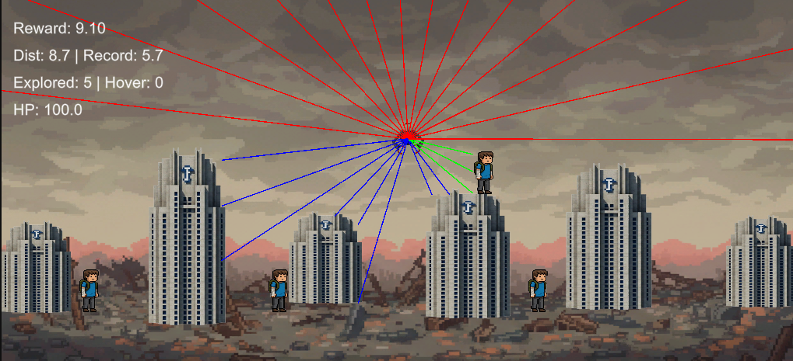
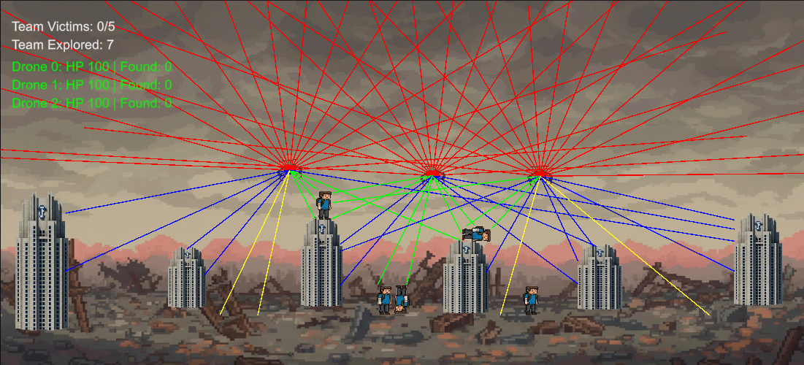

# Autonomous Drone for Search and Rescue (2D) using Deep Reinforcement Learning

_A Unity ML-Agents project focused on training autonomous drones for Search and Rescue (SAR) tasks in complex 2D environments. This repository contains the source code, trained models, and complete documentation for both single-agent and cooperative multi-agent systems._

> [!NOTE]
> This repository contains the **2D** baseline phase of the research project. For the 3D multi-agent drone system with full 6-DOF physics, see [Unity_ML_3DAgent](https://github.com/saiefadnan/Unity_ML_3DAgent). For the complete research narrative and 2D-to-3D experimental matrix, see the [Thesis Roadmap](https://github.com/saiefadnan/Unity_ML_3DAgent/blob/main/THESIS_ROADMAP.md).

---

## Visual Demonstrations

| Single-Agent System (S1) | Cooperative Multi-Agent System (S2) |
| :---: | :---: |
| [](./contents/single2d.mp4) | [](./contents/multi2D.mp4) |
| *Single drone navigating 2D obstacle arena*<br>[🎬 Watch S1 Flight Video](./contents/single2d.mp4) | *3-drone cooperative swarm searching arena*<br>[🎬 Watch S2 Flight Video](./contents/multi2D.mp4) |

---

## Key Features

- **Advanced RL Algorithm**: Utilizes Proximal Policy Optimization (PPO) with a Long Short-Term Memory (LSTM) network to enable sophisticated, memory-driven navigation.
- **Two Distinct Systems**:
  - **Single-Agent (S1)**: A baseline system with one drone navigating the environment.
  - **Multi-Agent (S2)**: A cooperative team of three drones using a shared policy and GPS-based communication to enhance exploration and efficiency.
- **Complex Reward Shaping**: A dense reward function guides the agent to learn safe and efficient flight, with specific incentives for progress, stability, and exploration, and penalties for crashes or inefficiency.
- **Curriculum Learning**: Agents are trained through a multi-stage curriculum that gradually increases task difficulty, from basic hovering to navigating cluttered environments.
- **Comprehensive Documentation**: Includes detailed documentation on the environment, RL algorithm, network architecture, reward design, and performance results.

---

## Technology Stack

- **Engine**: Unity 2022.3.15f1
- **RL Framework**: Unity ML-Agents Release 20
- **Programming Languages**: C# (for Unity environment/agent logic) and Python 3.8+ (for training and evaluation)
- **Libraries**: PyTorch, NumPy, Pandas

---

## Getting Started

### Prerequisites

- Unity Editor (2022.3.15f1 or later)
- Python 3.8+
- Unity ML-Agents package installed in Unity
- `ml-agents` Python package installed

```bash
# Clone the repository
git clone https://github.com/saiefadnan/Unity_ML_Agent.git
cd Unity_ML_Agent

# Set up Python virtual environment
python -m venv venv
# Activate on Windows:
venv\Scripts\activate
# Activate on Linux/macOS:
source venv/bin/activate

# Install dependencies
pip install mlagents torch pandas numpy
```

### Running Inference

To see the trained agents in action, use the `mlagents-learn` command with the `--inference` flag:

```powershell
# Run the Single-Agent (S1) model (drone6.10)
mlagents-learn config2D/single_occ.yaml --run-id=drone6.10 --inference

# Run the Multi-Agent (S2) model (drone7.2)
mlagents-learn config2D/multi_gps.yaml --run-id=drone7.2 --inference
```

### Training a New Model

To start a new training run from scratch:

```powershell
# Train a new single-agent model
mlagents-learn config2D/single_occ.yaml --run-id=NewSingleAgentRun --train

# Train a new multi-agent model
mlagents-learn config2D/multi_gps.yaml --run-id=NewMultiAgentRun --train
```

Training progress can be monitored via TensorBoard:
```powershell
tensorboard --logdir results
```

---

## Repository Structure

```
/
├── 📄 README.md           # You are here (2D SAR Project Overview)
├── 📂 config2D/           # Trainer configuration (.yaml) files for PPO
├── 📂 contents/           # Demo videos and demonstration images
├── 📂 data/               # Raw test evaluation data (.csv)
├── 📂 docs/               # Detailed technical documentation
├── 📂 results/            # Trained models (.onnx) and TensorBoard logs
└── 📂 scripts/            # C# source code for the Unity environment
    ├── 📂 single_agent_scripts/ # Single-agent C# scripts (Agent2D, EnvManager)
    └── 📂 multi_agent_scripts/  # Multi-agent C# scripts (MultiAgent2D, MultiEnvManager)
```

---

## Performance Summary

Evaluation results across 100 benchmark episodes (canonical metrics from [Table V](https://github.com/saiefadnan/Unity_ML_3DAgent/blob/main/output/result/TABLE_V_Test_Results.txt)):

| Metric | Single-Agent (S1) | Multi-Agent (S2) | Improvement / Difference |
|---|---|---|---|
| **Mission Success Rate** | 65.0% | **100.0%** | **+53.8%** (+1900% vs. Random) |
| **Avg Victims Rescued** | 3.90 / 6 | **6.00 / 6** | **+53.8%** (100% arena clearance) |
| **Avg Steps to Complete** | 553 | **266** | **-51.9%** (2× faster mission completion) |
| **Completion Time (s)** | 27.67 s | **13.28 s** | **-52.0%** (Halved operational duration) |
| **Avg Drone HP Survival** | -2.94 | **96.08** | **+103%** (Near-zero crash destruction) |
| **Path Efficiency** | 0.240 | **1.726** | **+619%** (Direct, coordinated trajectories) |
| **Area Coverage (cells)** | 12.5 | **23.3** | **+86.4%** (Comprehensive team search) |

> Cooperative multi-agent coordination (S2) achieves a 100% mission clearance rate, doubles search speed, and virtually eliminates drone destruction compared to single-agent operation.

---

## Detailed Documentation

For a deep dive into the project's technical implementation, including environment design, algorithm hyperparameters, reward functions, and performance analysis, please refer to the complete documentation suite located in the `/docs` directory:

- [Project Overview](./docs/overview.md) — System architecture diagram and setup summary
- [Environment and Task Definition](./docs/environment_and_task.md) — 2D physics world, bounds, and observation/action spaces
- [Reinforcement Learning Algorithm](./docs/rl_algorithm.md) — PPO trainer configuration, LSTM memory, and curriculum
- [Reward Signal Design](./docs/reward_design.md) — Detailed reward functions and penalty structure
- [Network Architecture](./docs/network_architecture.md) — Policy network dimensions and data flow
- [Multi-Agent System](./docs/multi_agent.md) — Multi-drone cooperative behavior, GPS communication, and territory allocation
- [Results and Analysis](./docs/results.md) — Quantitative performance breakdown and comparison tables
- [Thesis Roadmap (3D Extension)](https://github.com/saiefadnan/Unity_ML_3DAgent/blob/main/THESIS_ROADMAP.md) — Cross-environment 2D-to-3D thesis plan and ablation studies
